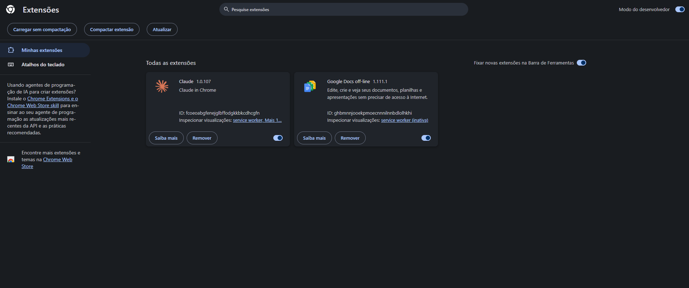
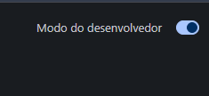
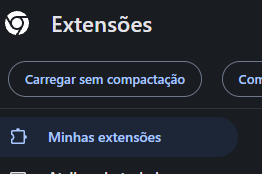
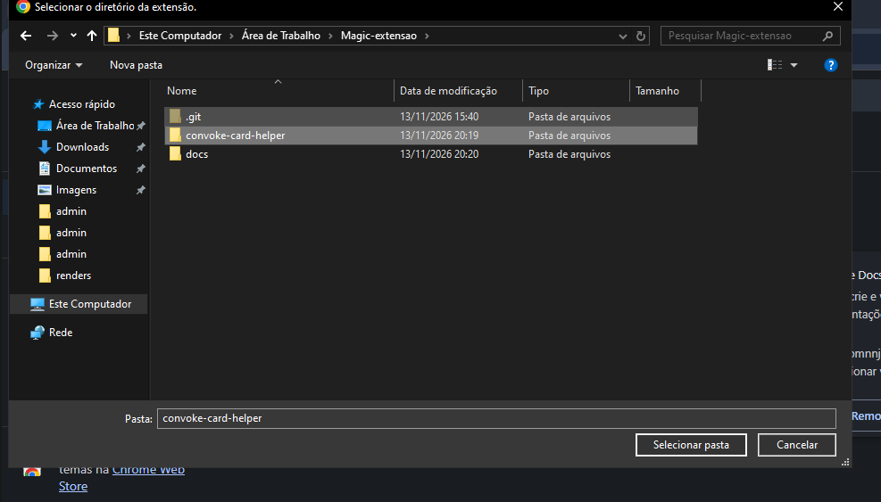
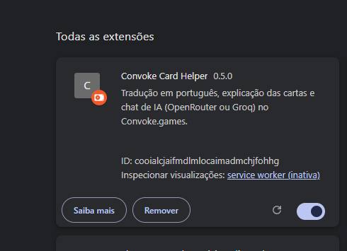

# 🧙 Convoke Card Helper

Extensão de navegador para o **[Convoke.games](https://convoke.games)** (Magic: The Gathering / Commander online) que:

- 🇧🇷 **Traduz as cartas para português** quando você dá zoom nelas. Usa o texto oficial impresso em PT quando a carta existe em português; senão, tradução automática.
- 📖 **Explica os termos da carta** (Voar, Toque Mortífero, ETB, custo de mana…) sem precisar de IA.
- ⚖️ **Mostra os esclarecimentos oficiais (rulings)** traduzidos.
- 🤖 **Chat com IA** para tirar dúvidas sobre a carta ou sobre regras em geral. Funciona com **Groq** (grátis) ou **OpenRouter**.

> 🚧 **Projeto em fase beta.** A extensão ainda está no começo e tem várias melhorias pela frente. Podem aparecer bugs, como o painel abrindo em telas onde não deveria, traduções automáticas estranhas ou o layout mudando quando o Convoke atualizar o site. Se encontrar algum problema ou tiver uma sugestão, abra uma [issue](../../issues) aqui no GitHub.

---

## Sumário

1. [Baixar a extensão](#1-baixar-a-extensão)
2. [Instalar no navegador](#2-instalar-no-navegador)
3. [Configurar a IA (opcional)](#3-configurar-a-ia-opcional)
4. [Como usar](#4-como-usar)
5. [Atualizar](#5-atualizar)
6. [Problemas comuns](#6-problemas-comuns)
7. [Privacidade](#7-privacidade)

---

## 1. Baixar a extensão

A extensão ainda não está na loja do Chrome, então você baixa os arquivos direto daqui do GitHub.

**Passo 1 —** No topo desta página do GitHub, clique no botão verde **`<> Code`**.

**Passo 2 —** No menu que abrir, clique em **Download ZIP**. O navegador baixa um arquivo `.zip` (normalmente vai para a pasta **Downloads**).

**Passo 3 —** Extraia o arquivo: clique com o botão direito no `.zip` → **Extrair tudo…** → escolha onde salvar → **Extrair**.

- Pode extrair na **Área de Trabalho** sem problema.
- O ZIP vem com uma pasta de fora (o nome do projeto, terminando em `-main`) e, dentro dela, a pasta **`convoke-card-helper`**. É essa pasta de dentro, a que tem o arquivo `manifest.json`, que você vai selecionar na instalação.

> ⚠️ **Não apague, não mova e não renomeie a pasta depois de instalar.** O navegador lê a extensão direto dessa pasta. Se ela sumir ou mudar de lugar, a extensão para de funcionar e você precisa **importar de novo** (passo 2 inteiro).
>
> O arquivo `.zip` pode ser apagado depois de extrair. A pasta extraída, não.

---

## 2. Instalar no navegador

### Links rápidos

Copie o endereço e cole na barra de endereços do navegador. Esses endereços não abrem clicando, o navegador bloqueia.

| Navegador | Endereço da página de extensões |
|---|---|
| Google Chrome | `chrome://extensions/` |
| Brave | `brave://extensions/` |
| Microsoft Edge | `edge://extensions/` |
| Opera / Opera GX | `opera://extensions/` |
| Vivaldi | `vivaldi://extensions/` |

Todos esses navegadores são baseados no Chromium, então o processo é **igual em todos**. Os prints abaixo são do Chrome, mas no Brave, Edge, Opera e Vivaldi as telas são praticamente as mesmas.

### Passo a passo

**Passo 1 —** Cole o endereço do seu navegador (tabela acima) na barra de endereços e aperte Enter. Ex.: `chrome://extensions/` ou `brave://extensions/`.

**Passo 2 —** No canto superior direito, ative a chave **Modo do desenvolvedor**. No Edge, essa chave fica no menu da esquerda.

**Passo 3 —** Clique no botão **Carregar sem compactação**, que aparece no canto superior esquerdo depois do passo 2.

**Passo 4 —** Na janela que abrir, selecione a pasta **`convoke-card-helper`** e clique em **Selecionar pasta**.

> ⚠️ Selecione a pasta `convoke-card-helper`, não a pasta de fora. É ela que tem o arquivo `manifest.json`.

**Passo 5 —** O **Convoke Card Helper** aparece na lista de extensões, com a chave ligada. Pronto! ✅

**Passo 6 —** Abra ou recarregue (F5) a aba do **[convoke.games](https://convoke.games)**.

### Dicas

- Clique no ícone de quebra-cabeça 🧩 da barra do navegador e **fixe** o Convoke Card Helper. Clicar no ícone abre as configurações.
- O navegador pode mostrar um aviso de "extensões em modo de desenvolvedor". É normal para extensões instaladas assim, basta fechar o aviso.
- **Firefox não é suportado** por enquanto.

---

## 3. Configurar a IA (opcional)

A tradução e a explicação dos termos funcionam **sem configurar nada**. A chave só é necessária para o **chat com IA**.

Você escolhe um dos provedores:

| Provedor | Custo | Observação |
|---|---|---|
| **Groq** (recomendado) | Grátis | Muito rápido. Tem limite de uso por minuto/dia, que normalmente sobra para uso pessoal. |
| **OpenRouter** | Grátis ou pago | Centenas de modelos. Os gratuitos (marcados "grátis") têm limite diário. |

### Groq (grátis)

1. Crie uma conta em **[console.groq.com](https://console.groq.com)**.
2. Vá em **[API Keys](https://console.groq.com/keys)** → **Create API Key** e copie a chave (começa com `gsk_`).
3. No Convoke, clique no ícone da extensão (ou no ⚙ do chat) para abrir as configurações.
4. Em **Provedor**, escolha **Groq**.
5. Cole a chave e clique em **Testar** — a lista de modelos aparece.
6. Escolha um modelo (ex.: um `llama` ou `gpt-oss`) e clique em **Salvar**.

### OpenRouter

1. Crie uma conta em **[openrouter.ai](https://openrouter.ai)**.
2. Crie uma chave em **[openrouter.ai/keys](https://openrouter.ai/keys)** (começa com `sk-or-v1-`).
3. Nas configurações da extensão, escolha **OpenRouter**, cole a chave e clique em **Testar**.
4. Deixe marcado **"Mostrar somente modelos gratuitos"** se não quiser gastar nada, escolha um modelo e **Salvar**.

> 🔒 A chave fica salva **só no seu navegador** e é enviada apenas para o provedor escolhido.

---

## 4. Como usar

### Ver uma carta em português

Durante a partida, **dê zoom em uma carta** (como você já faz no Convoke). A extensão mostra:

- **À esquerda:** nome, tipo e texto em português, termos explicados e rulings oficiais.
- **À direita:** chat com IA sobre aquela carta.

Para **fechar os painéis**, clique no **✕** no canto do painel ou aperte **Esc**. Eles voltam quando você der zoom em outra carta.

### Chat de regras

Clique no botão flutuante **🧙** (canto inferior direito) para abrir um chat geral sobre regras de Magic, sem precisar de uma carta.

Dicas:
- Use os botões de pergunta rápida ("Explique essa carta de forma simples", "Quais combos ela tem?"…).
- Cada carta tem seu próprio histórico de conversa.
- 🗑 limpa a conversa; ⚙ abre as configurações.

---

## 5. Atualizar

1. Baixe o ZIP novo e substitua os arquivos da pasta `convoke-card-helper` (mesma pasta de antes).
2. Abra a página de extensões (`chrome://extensions/` ou `brave://extensions/`) e clique no ícone de **recarregar** (↻) do Convoke Card Helper.
3. Recarregue a aba do Convoke (F5).

Suas configurações e chave continuam salvas.

---

## 6. Problemas comuns

| Problema | Solução |
|---|---|
| Painel travado em "Carregando…" ou nada aparece ao dar zoom | Recarregue a aba do Convoke (F5). Confira se a extensão está **ativada** na página de extensões. |
| "Não foi possível carregar esta carta" | Falha momentânea do Scryfall ou da internet. Feche e abra o zoom de novo. |
| "Limite de uso atingido" | O plano gratuito chegou no limite. Espere um pouco ou troque de modelo. |
| "Chave inválida" | Confira se copiou a chave inteira e se escolheu o provedor certo (Groq × OpenRouter). |
| "O modelo não retornou texto" | Alguns modelos gratuitos gastam a resposta "pensando". Tente de novo ou troque de modelo. |
| Erro "Manifest file is missing" ao instalar | Você selecionou a pasta errada. Selecione a pasta **`convoke-card-helper`**, que contém o `manifest.json`. |
| A extensão sumiu depois de mover a pasta | Remova a extensão e instale de novo apontando para o novo local. |

---

## 7. Privacidade

- A extensão só roda em **convoke.games**.
- Para buscar e traduzir cartas, ela consulta o **[Scryfall](https://scryfall.com)** e o **Google Tradutor** (só o texto da carta é enviado).
- O chat envia sua pergunta e o texto da carta para o provedor de IA escolhido (**Groq** ou **OpenRouter**), usando a **sua** chave.
- Nenhum dado é enviado para servidores do autor da extensão. A chave da API fica salva apenas no armazenamento local do navegador.
